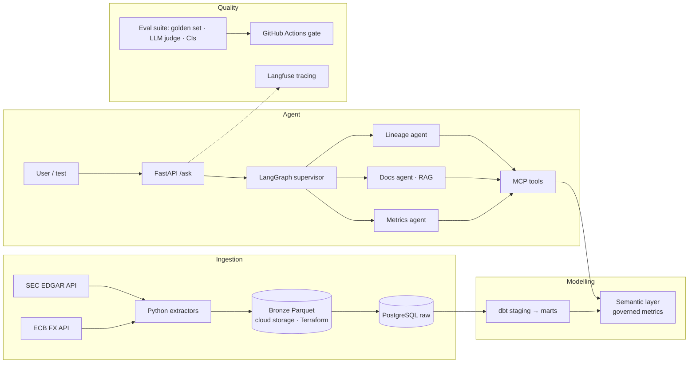

# metrics-first-agent

**A finance AI agent that answers questions only through governed metrics, and proves its answers are right.**

Built on real public data (SEC EDGAR company filings + ECB exchange rates): dbt models on PostgreSQL, a semantic layer that defines every metric once, and a LangGraph agent that can only query those metrics, never raw SQL. Every run is traced in Langfuse, and every change is gated by an LLM evaluation suite in CI.

> 🚧 **Work in progress.** See [Status](#status) for what is built so far.

---

## Why this project

Most "chat with your data" demos let an LLM write SQL directly. That fails in practice: the model joins the wrong tables, invents formulas, and gives different numbers for the same question. Teams that run AI on data in production solve this with a **semantic layer**: metrics are defined once, and the AI may only ask for them by name.

This project shows that approach end to end, and adds what is usually missing: **evidence**. A versioned golden dataset, an LLM judge calibrated against human labels, and confidence intervals measure whether the agent can be trusted.

## Example

**Question:** *"What was JPMorgan's net margin in 2024, and how did it change from 2023?"*

1. The **supervisor** classifies the question → `metric_question`, company JPMorgan, metric `net_margin`, years 2023–2024.
2. The **metrics agent** calls `find_company("JPMorgan")` → CIK `0000019617`, then `query_metric("net_margin", ...)` for each year.
3. The **answer node** writes the reply with sources, and a check confirms every number matches the tool results.

```json
{
  "answer": "JPMorgan Chase & Co.'s net margin was X% in 2024, up from Y% in 2023.",
  "sources": ["metric:net_margin", "model:fct_ratios"],
  "trace_id": "..."
}
```

## Architecture



## Tech stack

| Layer | Tools |
|---|---|
| Infrastructure | Terraform (Azure storage), Docker Compose |
| Ingestion | Python, requests, pandas, Parquet, pytest |
| Warehouse & modelling | PostgreSQL, dbt (dbt-postgres), dbt MetricFlow |
| Agent | FastAPI, LangGraph, MCP, pgvector (RAG over dbt docs) |
| LLM providers | Anthropic (Claude), OpenAI (switchable) |
| Observability | Langfuse |
| Evaluation & CI | Golden dataset, LLM-as-judge, Cohen's kappa, bootstrap CIs, GitHub Actions |

## Data sources

| Source | What | Notes |
|---|---|---|
| [SEC EDGAR company facts](https://www.sec.gov/edgar/sec-api-documentation) | Reported financials (XBRL) for 10–20 banks, insurers and asset managers | User-Agent with contact email required; ≤10 requests/second |
| [ECB Data Portal](https://data.ecb.europa.eu/) | Daily USD/EUR reference rates | Rate = USD per 1 EUR → EUR = USD ÷ rate |

## Repository structure

```
metrics-first-agent/
├── infra/                 # Terraform: storage for bronze data
├── extractors/            # SEC + ECB extractors (fetch and parse kept separate)
├── config/                # concept_map.yml, company list
├── dbt/                   # staging, marts, snapshots, tests, semantic models
├── rag/                   # index dbt docs into pgvector
├── agent/                 # FastAPI app, LangGraph graph, MCP tools
├── evals/                 # golden datasets (versioned), judge prompts, reports
├── tests/                 # unit tests + offline fixtures
├── .github/workflows/     # CI: tests, dbt build, eval gate
└── docker-compose.yml     # PostgreSQL (+ pgvector), Langfuse
```

## Getting started

> Commands will be filled in as each phase is completed.

```bash
git clone https://github.com/SrijoniChakra/metrics-first-agent.git
cd metrics-first-agent
cp .env.example .env            # add SEC_USER_AGENT, API keys
pip install -r requirements.txt
docker compose up -d            # PostgreSQL + Langfuse
make ingest                     # SEC + ECB → bronze → PostgreSQL
make dbt                        # dbt build + docs
make serve                      # FastAPI agent on http://localhost:8000
make eval                       # run the evaluation suite
```

## Status

**Epic 1: Ingestion**
- [ ] 1.1 SEC extractor proof of concept
- [ ] 1.2 Scale SEC extractor to 10–20 companies + Parquet + tests
- [ ] 1.3 ECB FX extractor + Parquet + tests
- [ ] 1.4 Terraform storage
- [ ] 1.5 Upload bronze to cloud storage
- [ ] 1.6 Load bronze into PostgreSQL
- [ ] 1.7 Incremental loading
- [ ] 1.8 One-command run

**Epic 2: dbt models** — staging (dedupe restated filings, fiscal year from period end), marts, snapshots, tests
**Epic 3: Semantic layer** — net margin, ROE, ROA, equity ratio, revenue growth
**Epic 4: Agent** — FastAPI, LangGraph supervisor, MCP tools, RAG docs agent, retries, two LLM providers, Langfuse
**Epic 5: Evaluation** — golden dataset, LLM judge calibration, confidence intervals, comparisons
**Epic 6: CI gate & write-up** — GitHub Actions eval gate, results, blog post

## Evaluation results

*Coming in Epic 5.* The planned results table:

| Setup | Correct (of 50) | 95% CI | Judge–human agreement |
|---|---|---|---|
| Agent via metrics (Claude) | – | – | – |
| Agent via metrics (OpenAI) | – | – | – |
| Naive text-to-SQL baseline | – | – | – |

## Key design decisions

- **Metrics, not SQL:** the agent can only call governed metric tools, so numbers are consistent and cannot be invented.
- **Keyed on the SEC CIK:** company names are not stable identifiers; every table uses the CIK.
- **Keep everything in bronze, dedupe in dbt:** SEC filings repeat and restate figures; the latest filing wins in staging, so history stays traceable.
- **Evaluation gates every change:** a pull request that lowers accuracy beyond the confidence interval fails CI.

## Author

**Srijoni Chakraborty**, Data Engineer
[LinkedIn](https://www.linkedin.com/in/srijoni-chakraborty) · [GitHub](https://github.com/SrijoniChakra)
